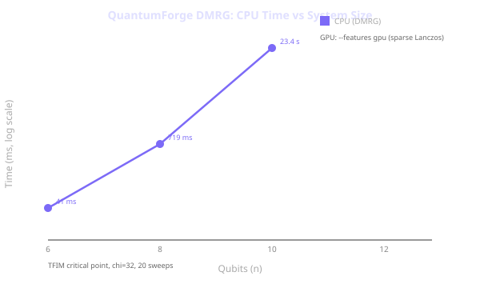

# QuantumForge

A pre-1.0 quantum-computing toolkit in Rust: an **exact-rational analytic
core**, a **CPU simulator** (state vectors + density matrices + seeded shots),
an **interactive REPL**, and optional **CUDA simulation / LLVM scalar JIT**
features.

[](https://github.com/Junshenhuang-571/QuantumForge/actions/workflows/ci.yml)

QuantumForge is for researchers, students, and developers who want a Rust
environment for learning and prototyping gate-model simulation, variational
algorithms, MBQC, adiabatic evolution, and reversible quantum Turing machines.
It is a classical simulator and research toolkit, not a quantum-hardware
runtime.

## Why this project matters

QuantumForge is designed to be more than a toy simulator. It aims to provide:

- a shared semantic layer across multiple quantum paradigms
- exact symbolic reasoning alongside numerical simulation
- a REPL for fast exploration and education
- optional acceleration for larger workloads
- a library API that can be embedded in Rust applications

## Who it's for

- researchers exploring quantum algorithms and Hamiltonians
- students learning quantum computing concepts hands-on
- developers prototyping simulation and optimization workflows
- teams building domain-specific quantum tooling around a Rust core

## Project health snapshot

The CPU simulator, command-line tools, and core algorithm modules are usable
today, but the project is pre-1.0 and evolving. In particular:

- state-vector simulation uses memory exponential in the qubit count; density
  matrices grow faster and are intended for small systems
- CUDA accelerates selected simulation paths; LLVM JIT compiles scalar numeric
  expressions, not quantum circuits
- IBM Quantum, IonQ, and Rigetti provider modules are interface scaffolds; job
  submission and device discovery are not implemented
- results and algorithms should be treated as research/educational tools, not
  independently validated scientific or production outputs

Contributions and issue reports are welcome; the current focus is on reliable
onboarding, explicit API expectations, and correctness across supported paths.

QuantumForge spans **five models of quantum computation** under one roof:

| Paradigm | What it is | `qf` command |
|---|---|---|
| **Circuit / gate model** | the standard qubits-and-gates model | `add`, `run`, `draw`, `shots` |
| **Variational (VQE / QML)** | parameterized circuits optimized classically | `vqe`, `train`, `qnn`, `gradient` |
| **Measurement-based (MBQC)** | the "one-way" model — cluster states measured adaptively | `mbqc edges=.. qubits=N pattern=SPEC` |
| **Adiabatic (AQC)** | evolve a ground state from a driver to a problem Hamiltonian | `anneal NAME T=.. tol=.. steps=..` |
| **Quantum Turing machine** | reversible transition unitaries on configuration superpositions | `qtm machine=counter\|scan\|erase cells=N` |

Every paradigm command is **data-driven** — supply your own cluster graph,
problem Hamiltonian, or tape size rather than running a fixed demo. The headline
feature is the `qf` REPL: build circuits incrementally, draw them as ASCII
diagrams, run and measure them, and run variational algorithms (VQE, QML
training) with results cross-checked against exact ground-state energies.
The default test suite covers core semantics, robustness properties, and REPL
end-to-end behavior.

## Quickstart

For a guided install and walkthrough, see [docs/getting-started.md](docs/getting-started.md).

Install and run the interactive REPL:

```bash
cargo install quantumforge
qf
```

Or build from source:

```bash
git clone https://github.com/Junshenhuang-571/QuantumForge.git
cd QuantumForge
cargo run --bin qf
```

Then build a Bell state, measure both qubits, and sample reproducible outcomes:

```
qf> qubits 2
qf> add H[0]
qf> add CNOT[0,1]
qf> add Measure[0,0]
qf> add Measure[1,1]
qf> draw
qf> shots 8 42
  |00>  4
  |11>  4
legend: ─ wire  • control  ⊕ target(X)  │ span  x swap  M measure
```

The `shots` command reruns the circuit from `|0...0>` and uses the supplied seed
to make the sample reproducible. To inspect the state without sampling, use
`run` followed by `state`.

Or use it as a library:

```rust
use quantumforge::{Circuit, StateVector, parse_circuit};

let circuit = parse_circuit("Circuit[H[0], CNOT[0,1], Measure[0,0]]").unwrap();
let initial = StateVector::zero(2).unwrap();
let result = circuit.run_shots(&initial, 1000, 42).unwrap();
println!("{:?}", result.counts);
```

## Example gallery

A few quick starting points:

- `examples/hello_world.rs` — minimal Bell-state example
- `examples/cost_aware_optimization.rs` — compare a rewrite against a
  target-weighted logical cost model
- `examples/qtm_probe.rs` — QTM exploration code
- `examples/gpu_bench.rs` — GPU benchmark entry point

## Highlights

- **Exact symbolic arithmetic where supported.** The analytic core
  (`PauliSum` / `ExactComplex` / `Rational`) represents supported expressions
  exactly. Variational optimization and state-vector simulation use floating
  point; VQE outcomes depend on the ansatz, optimizer, and convergence.
- **Interactive `qf` REPL** — live state, `draw` renders a real circuit diagram
  with vertical connectors across wires:
  ```
  q0 ───H──────•────────────────────•──────M─────────────────
  q1 ──────────⊕──────•─────────────│─────────────M──────────
  q2 ─────────────────⊕───Ry0.79────•────────────────────M───
  ```
- **Simulation**: state vectors, density matrices with noise channels
  (depolarizing / amplitude / phase damping), seeded reproducible shots, and a
  matrix-free sparse Lanczos eigensolver for ground-state energies.
- **Variational / QML**: `ParameterizedCircuit` with data encoding, adjoint +
  parameter-shift gradients (exact and finite-shot), and Adam trainers for
  regression and classification.
- **Algorithms**: Grover, QFT, QPE, Deutsch-Jozsa, Bernstein-Vazirani, HHL
  (linear systems), Shor (factoring). Quantum + classical hybrid solvers.
- **Visualization**: ASCII circuit diagrams (`draw`) and SVG export (`to_svg`).
- **Circuit optimization**: conservative and iterative rewrite passes, with
  before/after gate, depth, and qubit statistics. `CircuitCostProfile` and
  `CircuitCostModel` let you compare candidates using target-specific logical
  resource weights; they are estimates, not device timing predictions.
- **QEC**: Repetition, Shor, Steane, surface codes with MWPM decoder.
- **Backends**: optional `cuda` (NVRTC device-resident state vectors, density
  matrices, batched shots) and `llvm` (lower scalar expressions to LLVM IR /
  runtime-JIT), both validated against the Rust reference.

## Requirements

- Rust (edition 2024) and Cargo.
- Optional: CUDA toolkit + NVRTC (for `--features cuda`), LLVM tools
  (`opt`, `llc`) and `clang` (for `--features llvm` JIT).

## Build & test

```bash
cargo build            # default (CPU-only) build
cargo test             # 202 tests (default build; llvm/cuda tests need feature flags)
```

Run the interactive REPL:

```bash
cargo run --bin qf
```

## The `qf` REPL

Type `help` inside the REPL for the full command list. A quick tour:

```
qf> qubits 3
qf> add H[0]
qf> add CNOT[0,1]
qf> add Ry[Pi/4,2]
qf> draw                       # ASCII circuit diagram
qf> run
qf> add Measure[0,0]
qf> shots 1000 42              # seeded shots -> reproducible counts
```

Core commands: `qubits`, `circuit`, `draw`, `add`, `clear`, `run`, `noisy`,
`state`, `probs`, `ptrace Q1,Q2,...` (partial trace to a subsystem), `mix`
(maximally-mixed state), `expect X|Y|Z Q`, `bloch Q`, `shots N SEED`,
`shots-noise N SEED`, plus the analytic core (`eval`, `simplify`, `diff`,
`pauli`, `assume`).

### Variational & QML commands

| Command | What it does |
|---|---|
| `gradient X\|Y\|Z Q` | Adjoint vs parameter-shift gradient, cross-validated |
| `vqe <ham>` | Variational Quantum Eigensolver — minimizes `<H>` over the circuit's rotations and compares to the exact ground state |
| `train {regression\|classify} [DATA]` | Supervised QML (Adam). `DATA` is a flat brace list `{feat...,target, ...}` |
| `qnn [DATA]` | Minimal 1-parameter `VariationalQnn`, Adam or gradient descent |

Built-in VQE Hamiltonians (exact rational coefficients): `tfim`, `ising`,
`heisenberg`, `xxz`, `hubbard`. Example:

```
qf> qubits 3
qf> add Ry[0.3,0] ... (build a Ry+CNOT ansatz)
qf> vqe hubbard
  vqe ground energy = -0.686141
  exact ground energy = -0.686141
  |vqe - exact| = 5.92e-12  ✓ converged
```

### Tensor Network commands (TEBD / DMRG)

Imaginary-time evolution and variational ground-state search for 1D nearest-neighbor Hamiltonians (TFIM: `-Σ Z_i Z_{i+1} - Σ X_i`). Both use SVD-based truncation with bond-dimension control.

| Command | What it does |
|---|---|
| `tebd [qubits=N] [dt=..] [tol=..] [max-bond=..] [steps=N]` | TEBD imaginary-time evolution — outputs ground state energy, updates live MPS |
| `dmrg [qubits=N] [bond=..] [tol=..] [sweeps=N]` | DMRG variational sweeps — same Hamiltonian, sweeps until energy converges |
| `tebd-correl [site=..]` | Print `<Z_i Z_{i+1}>` from live TEBD MPS |
| `dmrg-correl [site=..]` | Print `<Z_i Z_{i+1}>` from live DMRG MPS |

Example:
```
qf> tebd qubits=6 dt=0.05 tol=1e-10 max-bond=32 steps=50
TEBD converged: ground state energy = -7.296230
qf> dmrg qubits=8 bond=64 tol=1e-12 sweeps=20
DMRG converged: ground state energy = -9.837951
```

Notes:
- TEBD computes the ground state via imaginary-time evolution (Trotter decomposition
  of exp(-βH)) with SVD truncation, verified against exact diagonalization for
  n ≤ 8 qubits. Results match DMRG to full precision.
- DMRG uses exact diagonalization (faer `self_adjoint_evd`) for n ≤ 12 qubits.
- For n ≥ 13 qubits, DMRG uses sparse Lanczos (Krylov subspace, m=100)
  with full reorthogonalization — verified against exact diagonalization for n=13
  (agreement to 6 decimal places).
- Correlation queries (`tebd-correl`, `dmrg-correl`) read from the live MPS;
  for exact-diagonalization systems the MPS is not yet reconstructed from
  the ground state, so single-site/correlation values may be approximate.

### GPU Sparse Lanczos (2D/3D models)
GPU-accelerated sparse Lanczos now works with **any** PauliSum Hamiltonian, including 2D and 3D lattice models. Previously, GPU sparse Lanczos was hardcoded for 1D TFIM only.

- `sparse_lanczos_gpu(&sparse_op, max_iter, tol)` — generic, works with `ising2d`, `heisenberg2d`, `ising3d`
- CSR sparse matrix-vector product kernel on GPU
- Enables ground-state computation for 2D/3D quantum systems on GPU

### New Spin Models
- `ising2d` — 2D Ising on square lattice (perfect square qubit count: 4, 9, 16, 25...)
- `heisenberg2d` — 2D Heisenberg on square lattice
- `ising3d` — 3D Ising on cubic lattice (perfect cube: 8, 27...)

### Entanglement Entropy
- `StateVector::entanglement_entropy(n_a)` — von Neumann entropy for bipartition
- Uses faer eigendecomposition of reduced density matrix

### Performance

Run `cargo bench` for criterion-based micro-benchmarks (state-vector gate application, density-matrix operations).

GPU acceleration activates for sparse Lanczos (>=13 qubits) and batched circuit execution. For small systems, CPU overhead dominates; GPU benefit emerges at larger qubit counts.

- `examples/gpu_bench.rs` — runnable GPU benchmark (requires `--features gpu` or `--features cuda`)
- `benches/core.rs` — criterion benchmarks for core operations

### Batched GPU Circuits

## Benchmark: CPU vs GPU

DMRG ground-state energy for TFIM (H = -Σ Z_i Z_{i+1} - Σ X_i). **Note:** for n ≤ 12, DMRG uses exact diagonalization (full 2^n eigendecomposition); for n ≥ 13, it uses sparse Lanczos (Krylov subspace). These are different algorithms — timings are not directly comparable across the 12/13 boundary. GPU acceleration activates for sparse Lanczos (>=13 qubits).



Stabilizer codes with syndrome extraction circuits and recovery tables. Currently supports bit-flip / phase-flip repetition codes, Shor's 9-qubit, Steane's 7-qubit, and planar/rotated surface codes. Includes MWPM decoder for single/multi-error recovery. Verified: all stabilizers commute, repetition code end-to-end correction, surface code d=3 has distinct syndromes for all single errors.

| Command | What it does |
|---|---|
| `qec-code [type=bitflip\|phaseflip\|shor\|steane\|surface] [n=..] [d=..]` | Build QEC code, print stabilizers + logical ops |
| `qec-encode [type=bitflip\|phaseflip] [n=..] [state=0\|1]` | Encode logical \|0⟩ or \|1⟩ into repetition code, updates live state |
| `qec-syndrome` | Measure syndrome on live state using code's circuit (pads with ancillas) |
| `qec-recover [syndrome=N]` | Apply recovery circuit for given syndrome bits |

Example:
```
qf> qec-code type=bitflip n=5
QEC Code: bitflip (n=5, k=1)
Stabilizers (4): S0=ZZIII, S1=IZZII, S2=IIZZI, S3=IIIZZ
qf> qec-encode type=bitflip n=5 state=1
Encoded logical |1> into 5-qubit repetition code
qf> qec-syndrome
Syndrome measurement complete. Ancilla qubits measured.
```

## Command-line binary

```bash
cargo run --bin main -- demo                            # one-qubit sim + QNN training
cargo run --bin main -- eval "2 + 3*Pi"
cargo run --bin main -- simplify "x + x + 2 + 3"
cargo run --bin main -- shots 2 1000 42 'Circuit[H[0], CNOT[0,1], Measure[0,0], Measure[1,1]]'
```

With feature flags: `llvm-ir` / `jit-eval` (llvm), `cuda-demo` (cuda).

## Library usage

```rust
use quantumforge::{Circuit, Gate, StateVector, parse_circuit};

// Build from a Wolfram-style expression, or the builder API.
let circuit = parse_circuit("Circuit[H[0], CNOT[0,1], Measure[0,0]]").unwrap();
let initial = StateVector::zero(2).unwrap();
let result = circuit.run_shots(&initial, 1000, 42).unwrap();
```

Key types: `Circuit` / `Gate` / `NoiseChannel`, `StateVector`, `DensityMatrix`,
`ParameterizedCircuit` (QML), `VariationalQnn`, and the analytic module's
`PauliSum` / `ExactComplex` / `Rational` / `ScalarExpr`.

### Compare circuit optimization costs

The optimizer reports structural resources so you can judge a rewrite against
your backend's priorities. For example, a fault-tolerant workload can assign a
higher weight to T gates, while a device with expensive entangling operations
can emphasize CNOT, CZ, and SWAP counts:

```rust
use quantumforge::{Circuit, Gate};
use quantumforge::optimizer::{
    CircuitCostModel, OptimizeConfig, optimize_for_cost_model,
};

let mut circuit = Circuit::new();
circuit.push(Gate::H, 0);
circuit.push(Gate::H, 0);
circuit.cnot(0, 1);

let model = CircuitCostModel {
    cnot_gate: 10.0,
    depth: 2.0,
    ..CircuitCostModel::default()
};
let (optimized, decision) =
    optimize_for_cost_model(&circuit, &OptimizeConfig::all(), &model)?;
println!(
    "selected ops {}, candidate ops {}, estimated cost {} -> {} (applied: {})",
    optimized.operations().len(),
    decision.optimization.optimized_ops,
    decision.original_cost,
    decision.candidate_cost,
    decision.applied,
);
# Ok::<(), quantumforge::optimizer::CircuitCostModelError>(())
```

The profile counts logical gates and dependency depth; it does not include
routing overhead, native gate decomposition, pulse schedules, or calibration
data. Set weights from the target's documented costs and compare circuits
using the same model. The optimizer remains a local rewrite pass, not a
hardware-aware global synthesis engine. `optimize_for_cost_model` returns the
original circuit unless the configured rewrite strictly lowers the estimated
cost; invalid or non-finite weights are rejected.

## QASM 2.0 support

Import/export circuits in the standard OpenQASM 2.0 format:

```rust
use quantumforge::{qasm::parse_qasm, StateVector};

let qasm = r#"
OPENQASM 2.0;
include "qelib1.inc";
qreg q[2];
creg c[2];
h q[0];
cx q[0], q[1];
measure q[0] -> c[0];
measure q[1] -> c[1];
"#;

let circuit = parse_qasm(qasm).unwrap();
let n_qubits = quantumforge::qasm::qubit_count(qasm).unwrap(); // returns 2
let initial = StateVector::zero(n_qubits).unwrap();
let result = circuit.run_shots(&initial, 1000, 42).unwrap();
```

Supported features: gates (X, Y, Z, H, S, S†, T, T†, RX, RY, RZ, U1, U2, U3, CX, CZ, SWAP, CCX), parameter expressions (`pi`, `pi/2`, `2*pi`), `measure`, `barrier`, `reset`, and user-defined gates with formal parameters.

## Optional features

```bash
cargo build --features llvm    # LLVM IR lowering + runtime JIT for scalar exprs
cargo build --features cuda    # CUDA/NVRTC device-resident simulation
cargo test --features cuda     # validated against the CPU reference
```

## Project layout

```
src/lib.rs            kernel entry, Circuit / StateVector / ParameterizedCircuit / VariationalQnn
src/bin/qf.rs         the interactive REPL
src/bin/main.rs       the CLI (demo/eval/simplify/shots/...)
src/analytic.rs       exact-rational core: PauliSum, ScalarExpr, Rational
src/quantum.rs        operators, observables, time-dependent evolution
src/parser.rs         Wolfram-style circuit + scalar expression parser
src/qtm.rs            Quantum Turing Machines (Bernstein–Vazirani unitary formulation)
src/mbqc.rs           Measurement-Based QC (cluster states + measurement patterns)
src/aqc.rs            Adiabatic QC (H(s) schedule driver + ground-state tracking)
src/cuda.rs           CUDA backend (feature = cuda)
src/llvm_backend.rs   LLVM IR + JIT (feature = llvm)
tests/                integration tests (incl. property-based + REPL end-to-end)
benches/core.rs       criterion benchmarks (state-vector, density, exact core)
RUST_CAS_ROADMAP.md   design notes and progress log
```

## CI

Every push and PR runs GitHub Actions (`.github/workflows/ci.yml`):
`cargo fmt --check`, `cargo clippy --all-targets -- -D warnings`, `cargo build`,
and `cargo test`. Reproduce locally:

```bash
cargo fmt --all -- --check
cargo clippy --all-targets -- -D warnings
cargo test
```

## Project policies

- [API stability policy](API_STABILITY.md)
- [Roadmap](ROADMAP.md)
- [Release checklist](docs/releasing.md)
- [Contributing guide](CONTRIBUTING.md)

## License

Licensed under the Apache License, Version 2.0 — see [LICENSE](LICENSE).

## Connection 
Email: junshenhuangc@126.com

## Contributors

We welcome contributions from all hardware platforms! See [CONTRIBUTING.md](CONTRIBUTING.md) for guidelines.

- **NVIDIA GPU** — primary development platform
- **macOS** — CI tested, contributions welcome
- **AMD/Intel GPU** — contributions welcome (ROCm/HIP, oneAPI)

### Community Circuit Benchmarks (Real MQT Bench Circuits)

Measured on a single machine (debug build). Circuits downloaded from MQT Bench and transpiled to basic gates. Run `cargo run --example bench_mqt` to reproduce.

| Circuit | Qubits | Gates | Time (ms) | Norm |
|---------|--------|-------|-----------|------|
| GHZ | 4 | 4 | 0.003 | 1.0000000000 |
| GHZ | 8 | 8 | 0.086 | 1.0000000000 |
| Grover | 4 | 164 | 0.046 | 1.0000000000 |
| Bernstein-Vazirani | 4 | 10 | 0.006 | 1.0000000000 |
| Bernstein-Vazirani | 8 | 24 | 0.095 | 1.0000000000 |
| Deutsch-Jozsa | 4 | 15 | 0.016 | 1.0000000000 |
| Deutsch-Jozsa | 8 | 33 | 0.141 | 1.0000000000 |
| QFT | 4 | 76 | 0.036 | 1.0000000000 |
| QFT | 8 | 328 | 1.150 | 1.0000000000 |

All circuits from MQT Bench (munich-quantum-toolkit/bench), transpiled to basic gates. All norms verified = 1.0.

