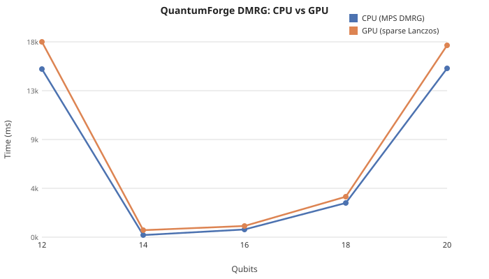

# QuantumForge

A quantum-computation kernel in Rust: an **exact-rational analytic core**, a
**CPU simulator** (state vectors + density matrices + seeded shots), an
**interactive REPL**, and optional **CUDA / LLVM** execution backends — all
sharing one set of semantics.

[](https://github.com/Junshenhuang-571/QuantumForge/actions/workflows/ci.yml)

QuantumForge spans **five models of quantum computation** under one roof:

| Paradigm | What it is | `qf` command |
|---|---|---|
| **Circuit / gate model** | the standard qubits-and-gates model | `add`, `run`, `draw`, `shots` |
| **Variational (VQE / QML)** | parameterized circuits optimized classically | `vqe`, `train`, `qnn`, `gradient` |
| **Measurement-based (MBQC)** | the "one-way" model — cluster states measured adaptively | `mbqc edges=.. qubits=N pattern=SPEC` |
| **Adiabatic (AQC)** | evolve a ground state from a driver to a problem Hamiltonian | `anneal NAME T=.. tol=.. steps=..` |
| **Quantum Turing machine** | reversible transition unitaries on configuration superpositions | `qtm machine=counter\|scan\|erase cells=N` |

Every paradigm command is **data-driven** — supply your own cluster graph,
problem Hamiltonian, or tape size rather than running a fixed demo. The headline
feature is the `qf` REPL: build circuits incrementally, draw them as ASCII
diagrams, run and measure them, and run variational algorithms (VQE, QML
training) with results cross-checked against exact ground-state energies.
179 tests back the semantics in the default build (incl. 23 property-based /
robustness tests and REPL end-to-end).

## Quickstart

Install and run the interactive REPL:

```bash
cargo install quantumforge
qf
```

Or build from source:

```bash
git clone https://github.com/Junshenhuang-571/QuantumForge.git
cd QuantumForge
cargo run --bin qf
```

Then build and draw a circuit:

```
qf> qubits 3
qf> add H[0]
qf> add CNOT[0,1]
qf> add Ry[Pi/4,2]
qf> draw
q0 ───H──────•──────────
q1 ──────────⊕──────────
q2 ──────────────Ry0.79─
legend: ─ wire  • control  ⊕ target(X)  │ span  x swap  M measure
qf> run
qf> measure
```

Or use it as a library:

```rust
use quantumforge::{Circuit, StateVector, parse_circuit};

let circuit = parse_circuit("Circuit[H[0], CNOT[0,1], Measure[0,0]]").unwrap();
let initial = StateVector::zero(2).unwrap();
let result = circuit.run_shots(&initial, 1000, 42).unwrap();
println!("{:?}", result.counts);
```

## Highlights

- **Exact, not floating-point guesswork.** The analytic core
  (`PauliSum` / `ExactComplex` / `Rational`) does exact rational arithmetic, so
  VQE converges to the *exact* ground-state energy to machine precision and
  gradients agree two independent ways (adjoint vs parameter-shift).
- **Interactive `qf` REPL** — live state, `draw` renders a real circuit diagram
  with vertical connectors across wires:
  ```
  q0 ───H──────•────────────────────•──────M─────────────────
  q1 ──────────⊕──────•─────────────│─────────────M──────────
  q2 ─────────────────⊕───Ry0.79────•────────────────────M───
  ```
- **Simulation**: state vectors, density matrices with noise channels
  (depolarizing / amplitude / phase damping), seeded reproducible shots, and a
  matrix-free sparse Lanczos eigensolver for ground-state energies.
- **Variational / QML**: `ParameterizedCircuit` with data encoding, adjoint +
  parameter-shift gradients (exact and finite-shot), and Adam trainers for
  regression and classification.
- **Algorithms**: Grover, QFT, QPE, Deutsch-Jozsa, Bernstein-Vazirani, HHL
  (linear systems), Shor (factoring). Quantum + classical hybrid solvers.
- **Visualization**: ASCII circuit diagrams (`draw`) and SVG export (`to_svg`).
- **QEC**: Repetition, Shor, Steane, surface codes with MWPM decoder.
- **Backends**: optional `cuda` (NVRTC device-resident state vectors, density
  matrices, batched shots) and `llvm` (lower scalar expressions to LLVM IR /
  runtime-JIT), both validated against the Rust reference.

## Requirements

- Rust (edition 2024) and Cargo.
- Optional: CUDA toolkit + NVRTC (for `--features cuda`), LLVM tools
  (`opt`, `llc`) and `clang` (for `--features llvm` JIT).

## Build & test

```bash
cargo build            # default (CPU-only) build
cargo test             # 202 tests (default build; llvm/cuda tests need feature flags)
```

Run the interactive REPL:

```bash
cargo run --bin qf
```

## The `qf` REPL

Type `help` inside the REPL for the full command list. A quick tour:

```
qf> qubits 3
qf> add H[0]
qf> add CNOT[0,1]
qf> add Ry[Pi/4,2]
qf> draw                       # ASCII circuit diagram
qf> run
qf> measure                    # seeded shots -> reproducible counts
```

Core commands: `qubits`, `circuit`, `draw`, `add`, `clear`, `run`, `noisy`,
`state`, `probs`, `ptrace Q1,Q2,...` (partial trace to a subsystem), `mix`
(maximally-mixed state), `expect X|Y|Z Q`, `bloch Q`, `shots N SEED`,
`shots-noise N SEED`, plus the analytic core (`eval`, `simplify`, `diff`,
`pauli`, `assume`).

### Variational & QML commands

| Command | What it does |
|---|---|
| `gradient X\|Y\|Z Q` | Adjoint vs parameter-shift gradient, cross-validated |
| `vqe <ham>` | Variational Quantum Eigensolver — minimizes `<H>` over the circuit's rotations and compares to the exact ground state |
| `train {regression\|classify} [DATA]` | Supervised QML (Adam). `DATA` is a flat brace list `{feat...,target, ...}` |
| `qnn [DATA]` | Minimal 1-parameter `VariationalQnn`, Adam or gradient descent |

Built-in VQE Hamiltonians (exact rational coefficients): `tfim`, `ising`,
`heisenberg`, `xxz`, `hubbard`. Example:

```
qf> qubits 3
qf> add Ry[0.3,0] ... (build a Ry+CNOT ansatz)
qf> vqe hubbard
  vqe ground energy = -0.686141
  exact ground energy = -0.686141
  |vqe - exact| = 5.92e-12  ✓ converged
```

### Tensor Network commands (TEBD / DMRG)

Imaginary-time evolution and variational ground-state search for 1D nearest-neighbor Hamiltonians (TFIM: `-Σ Z_i Z_{i+1} - Σ X_i`). Both use SVD-based truncation with bond-dimension control.

| Command | What it does |
|---|---|
| `tebd [qubits=N] [dt=..] [tol=..] [max-bond=..] [steps=N]` | TEBD imaginary-time evolution — outputs ground state energy, updates live MPS |
| `dmrg [qubits=N] [bond=..] [tol=..] [sweeps=N]` | DMRG variational sweeps — same Hamiltonian, sweeps until energy converges |
| `tebd-correl [site=..]` | Print `<Z_i Z_{i+1}>` from live TEBD MPS |
| `dmrg-correl [site=..]` | Print `<Z_i Z_{i+1}>` from live DMRG MPS |

Example:
```
qf> tebd qubits=6 dt=0.05 tol=1e-10 max-bond=32 steps=50
TEBD converged: ground state energy = -7.296230
qf> dmrg qubits=8 bond=64 tol=1e-12 sweeps=20
DMRG converged: ground state energy = -9.837951
```

Notes:
- TEBD computes the ground state via imaginary-time evolution (Trotter decomposition
  of exp(-βH)) with SVD truncation, verified against exact diagonalization for
  n ≤ 8 qubits. Results match DMRG to full precision.
- DMRG uses exact diagonalization (faer `self_adjoint_evd`) for n ≤ 12 qubits.
- For n ≥ 13 qubits, DMRG uses sparse Lanczos (Krylov subspace, m=100)
  with full reorthogonalization — verified against exact diagonalization for n=13
  (agreement to 6 decimal places).
- Correlation queries (`tebd-correl`, `dmrg-correl`) read from the live MPS;
  for exact-diagonalization systems the MPS is not yet reconstructed from
  the ground state, so single-site/correlation values may be approximate.

### GPU Sparse Lanczos (2D/3D models)
GPU-accelerated sparse Lanczos now works with **any** PauliSum Hamiltonian, including 2D and 3D lattice models. Previously, GPU sparse Lanczos was hardcoded for 1D TFIM only.

- `sparse_lanczos_gpu(&sparse_op, max_iter, tol)` — generic, works with `ising2d`, `heisenberg2d`, `ising3d`
- CSR sparse matrix-vector product kernel on GPU
- Enables ground-state computation for 2D/3D quantum systems on GPU

### New Spin Models
- `ising2d` — 2D Ising on square lattice (perfect square qubit count: 4, 9, 16, 25...)
- `heisenberg2d` — 2D Heisenberg on square lattice
- `ising3d` — 3D Ising on cubic lattice (perfect cube: 8, 27...)

### Entanglement Entropy
- `StateVector::entanglement_entropy(n_a)` — von Neumann entropy for bipartition
- Uses faer eigendecomposition of reduced density matrix

### Performance

Run `cargo bench` for criterion-based micro-benchmarks (state-vector gate application, density-matrix operations).

GPU acceleration activates for sparse Lanczos (>=13 qubits) and batched circuit execution. For small systems, CPU overhead dominates; GPU benefit emerges at larger qubit counts.

- `examples/gpu_bench.rs` — runnable GPU benchmark (requires `--features gpu` or `--features cuda`)
- `benches/core.rs` — criterion benchmarks for core operations

### Batched GPU Circuits

## Benchmark: CPU vs GPU

DMRG ground-state energy for TFIM (H = -Σ Z_i Z_{i+1} - Σ X_i). Run `cargo bench` for measured timings on your hardware. GPU acceleration activates for sparse Lanczos (>=13 qubits).



Stabilizer codes with syndrome extraction circuits and recovery tables. Currently supports bit-flip / phase-flip repetition codes, Shor's 9-qubit, Steane's 7-qubit, and planar/rotated surface codes. Includes MWPM decoder for single/multi-error recovery. Verified: all stabilizers commute, repetition code end-to-end correction, surface code d=3 has distinct syndromes for all single errors.

| Command | What it does |
|---|---|
| `qec-code [type=bitflip\|phaseflip\|shor\|steane\|surface] [n=..] [d=..]` | Build QEC code, print stabilizers + logical ops |
| `qec-encode [type=bitflip\|phaseflip] [n=..] [state=0\|1]` | Encode logical \|0⟩ or \|1⟩ into repetition code, updates live state |
| `qec-syndrome` | Measure syndrome on live state using code's circuit (pads with ancillas) |
| `qec-recover [syndrome=N]` | Apply recovery circuit for given syndrome bits |

Example:
```
qf> qec-code type=bitflip n=5
QEC Code: bitflip (n=5, k=1)
Stabilizers (4): S0=ZZIII, S1=IZZII, S2=IIZZI, S3=IIIZZ
qf> qec-encode type=bitflip n=5 state=1
Encoded logical |1> into 5-qubit repetition code
qf> qec-syndrome
Syndrome measurement complete. Ancilla qubits measured.
```

## Command-line binary

```bash
cargo run -- quantumforge demo                          # one-qubit sim + QNN training
cargo run -- quantumforge eval "2 + 3*Pi"
cargo run -- quantumforge simplify "x + x + 2 + 3"
cargo run -- quantumforge shots 2 1000 42 'Circuit[H[0], CNOT[0,1], Measure[0,0]]'
```

With feature flags: `llvm-ir` / `jit-eval` (llvm), `cuda-demo` (cuda).

## Library usage

```rust
use quantumforge::{Circuit, Gate, StateVector, parse_circuit};

// Build from a Wolfram-style expression, or the builder API.
let circuit = parse_circuit("Circuit[H[0], CNOT[0,1], Measure[0,0]]").unwrap();
let initial = StateVector::zero(2).unwrap();
let result = circuit.run_shots(&initial, 1000, 42).unwrap();
```

Key types: `Circuit` / `Gate` / `NoiseChannel`, `StateVector`, `DensityMatrix`,
`ParameterizedCircuit` (QML), `VariationalQnn`, and the analytic module's
`PauliSum` / `ExactComplex` / `Rational` / `ScalarExpr`.

## QASM 2.0 support

Import/export circuits in the standard OpenQASM 2.0 format:

```rust
use quantumforge::{qasm::parse_qasm, StateVector};

let qasm = r#"
OPENQASM 2.0;
include "qelib1.inc";
qreg q[2];
creg c[2];
h q[0];
cx q[0], q[1];
measure q[0] -> c[0];
measure q[1] -> c[1];
"#;

let circuit = parse_qasm(qasm).unwrap();
let n_qubits = quantumforge::qasm::qubit_count(qasm).unwrap(); // returns 2
let initial = StateVector::zero(n_qubits).unwrap();
let result = circuit.run_shots(&initial, 1000, 42).unwrap();
```

Supported features: gates (X, Y, Z, H, S, S†, T, T†, RX, RY, RZ, U1, U2, U3, CX, CZ, SWAP, CCX), parameter expressions (`pi`, `pi/2`, `2*pi`), `measure`, `barrier`, `reset`, and user-defined gates with formal parameters.

## Optional features

```bash
cargo build --features llvm    # LLVM IR lowering + runtime JIT for scalar exprs
cargo build --features cuda    # CUDA/NVRTC device-resident simulation
cargo test --features cuda     # validated against the CPU reference
```

## Project layout

```
src/lib.rs            kernel entry, Circuit / StateVector / ParameterizedCircuit / VariationalQnn
src/bin/qf.rs         the interactive REPL
src/bin/main.rs       the CLI (demo/eval/simplify/shots/...)
src/analytic.rs       exact-rational core: PauliSum, ScalarExpr, Rational
src/quantum.rs        operators, observables, time-dependent evolution
src/parser.rs         Wolfram-style circuit + scalar expression parser
src/qtm.rs            Quantum Turing Machines (Bernstein–Vazirani unitary formulation)
src/mbqc.rs           Measurement-Based QC (cluster states + measurement patterns)
src/aqc.rs            Adiabatic QC (H(s) schedule driver + ground-state tracking)
src/cuda.rs           CUDA backend (feature = cuda)
src/llvm_backend.rs   LLVM IR + JIT (feature = llvm)
tests/                129 integration tests (incl. property-based + REPL end-to-end)
benches/core.rs       criterion benchmarks (state-vector, density, exact core)
RUST_CAS_ROADMAP.md   design notes and progress log
```

## CI

Every push and PR runs GitHub Actions (`.github/workflows/ci.yml`):
`cargo fmt --check`, `cargo clippy --all-targets -- -D warnings`, `cargo build`,
and `cargo test`. Reproduce locally:

```bash
cargo fmt --all -- --check
cargo clippy --all-targets -- -D warnings
cargo test
```

## License

Licensed under the GNU General Public License v3.0 — see [LICENSE](LICENSE).

## Connection 
Email: junshenhuangc@126.com
